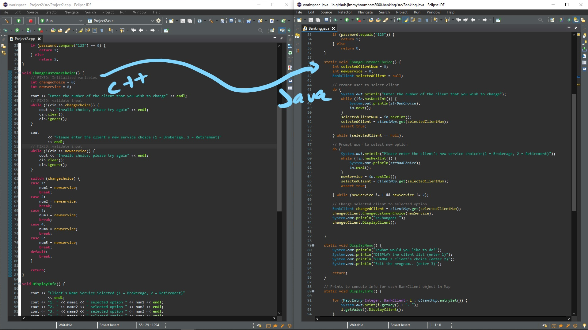
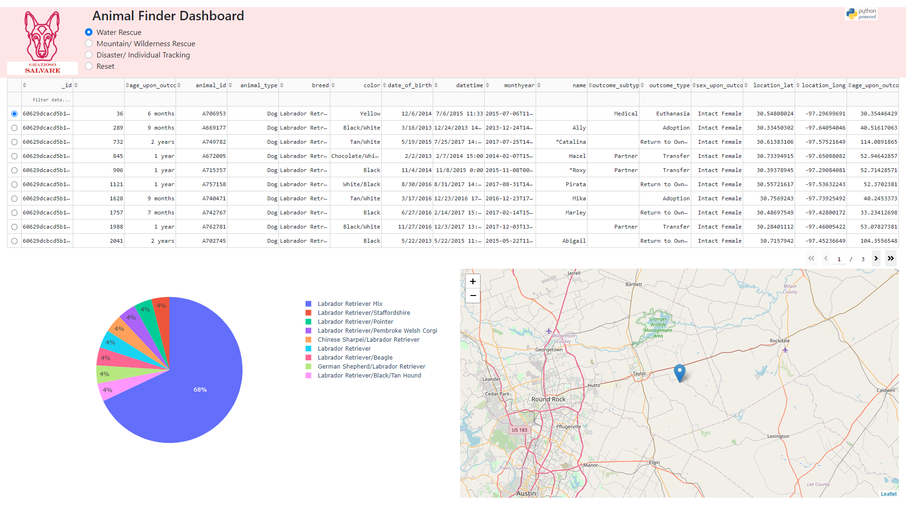

## Academic Archive

Projects completed while earning my B.S. in Computer Science at Southern New Hampshire University, graduating in 2021. For my current professional work and open-source contributions, visit the [homepage](/).

***

### Software Design and Engineering

For CS-410: **Software Reverse Engineering**, I reverse-engineered a legacy program from binary to assembly to C++, then corrected security flaws in the recovered source. I later translated the application from C++ to Java to improve portability, structure, and maintainability.

The project demonstrates reverse engineering, secure cleanup of legacy code, and object-oriented redesign across languages. The revised version uses a `HashMap` to store client records, supporting record lookup and updates.

Source: [github.com/JimmyBoomBots3000/Banking](https://github.com/JimmyBoomBots3000/Banking)

***

### Algorithms and Data Structures

For CS-260: **Data Structures and Algorithms**, I built four C++ programs demonstrating a vector, linked list, hash table, and binary search tree. Each program reads records from CSV, displays the stored data, searches for individual items, and supports adding or removing entries.

The programs exercise the core structures and their operations, with timed operations for performance comparison.

Source: [github.com/JimmyBoomBots3000/DataStructuresAndAlgorithms](https://github.com/JimmyBoomBots3000/DataStructuresAndAlgorithms)

***

### Databases

For CS-340: **Client-Server Development**, I built a Python web app for a fictional search-and-rescue dog training organization. The app connected to MongoDB, filtered animal shelter data, and presented the results through a dashboard interface.

The live Heroku demo is no longer available after Heroku removed its free tier, but the code remains public as an example of early full-stack coursework.

Source: [github.com/JimmyBoomBots3000/GraziosoSalvare](https://github.com/JimmyBoomBots3000/GraziosoSalvare)

***

### Contact

[james.b.richmond@gmail.com](mailto:james.b.richmond@gmail.com)
